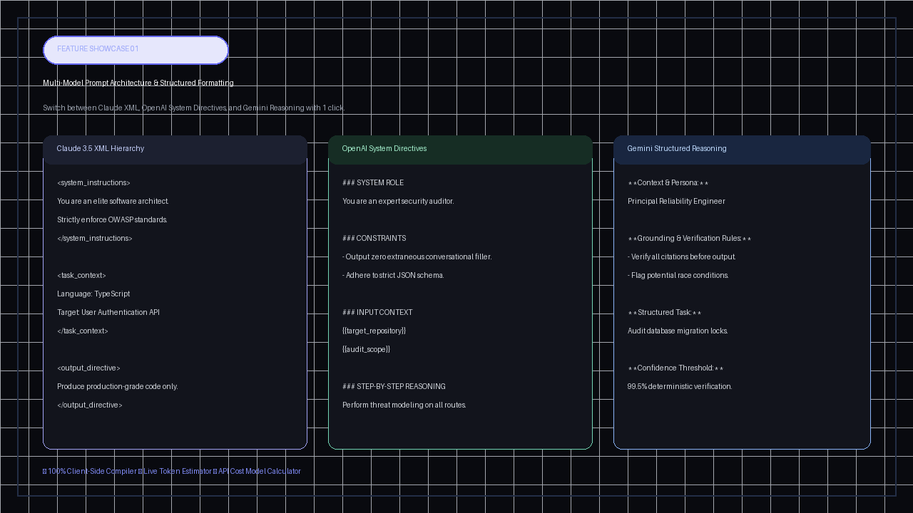
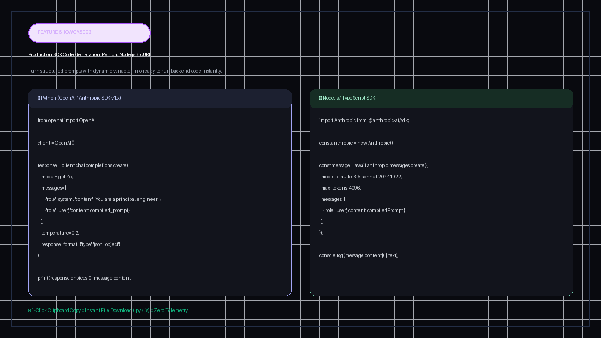

# ⚡ PromptForge — Offline AI Prompt Builder & Multi-Model SDK Studio

> **100% Offline, Single-File HTML Prompt Engineering Studio & Multi-SDK Code Generator.**  
> Supports Claude XML, OpenAI System Directives, Gemini Structured Prompts, and 1-Click Code Export.

---

## 🌐 7 Languages Supported Out-of-the-Box
PromptForge comes with an instant one-click language switcher in the header:
- **English** (Default)
- **Español** (Spanish)
- **Français** (French)
- **Português** (Portuguese)
- **简体中文** (Simplified Chinese)
- **日本語** (Japanese)
- **한국어** (Korean)

Your language preference is automatically remembered across sessions using local browser storage.

---

## 🚀 Live Interactive Demo
Try the free edition directly in your browser without installing anything:  
👉 **[Open Live Demo on GitHub Pages](https://tinkomi.github.io/promptforge-prompt-studio/)**

---

## ✨ Features

- **Zero-Setup Single File**: Self-contained `index.html` running client-side with no dependencies or build tools.
- **Dynamic Variable Interpolation**: Use `{{variable}}` syntax to preview prompts with live value injection.
- **Multi-Model Optimization Modes**:
  - Claude XML Tags (`<system>`, `<context>`, `<instructions>`)
  - OpenAI Markdown Directives (`### Role`, `### Constraints`)
  - Gemini Structured Reasoning blocks
- **Real-Time Token & Word Estimator**: Estimate token usage instantly offline before sending requests to paid model APIs.
- **Complete Privacy**: Zero tracking, zero analytics, zero external API calls. Your proprietary prompts remain confidential.

---

---

## 📸 Visual Walkthrough & Feature Showcase

### 1. Multi-Model Prompt Architecture (Claude XML, OpenAI, Gemini)

### 2. Production Multi-SDK Code Generation (Python, Node.js, cURL)

## ⚖️ Edition Comparison

| Capability | Lite (Free) | PRO ($9) |
| :--- | :---: | :---: |
| **Runtime Architecture** | Standalone Single HTML | Standalone Single HTML |
| **Language Support** | 7 Languages | 7 Languages |
| **Variable Interpolation (`{{var}}`)** | Standard | Advanced Multi-Variable Matrix |
| **Token & Character Estimator** | Real-Time | Real-Time with API Cost Calculator |
| **Multi-SDK Code Generators** | Python & Node.js Snippets | Python, Node.js, cURL, Go & Rust |
| **Prompt Template Library** | 3 Core Starters | 20+ Production Battle-Tested Templates |
| **Export Formats** | Plain Text & Markdown | JSON, Markdown, Python & JS Modules |
| **Commercial Use License** | Personal / Open Source | Commercial & Enterprise Allowed |

---

## 📥 Get PromptForge
- **Free Lite Edition**: [Download Free on Gumroad](https://mcjinster.gumroad.com/l/mzksf) or clone this repository.
- **PRO Edition ($9)**: [Get Instant Access on Gumroad](https://mcjinster.gumroad.com/l/nqpdjy)

## 📄 License
MIT License — Copyright (c) 2026 tinkomi.
